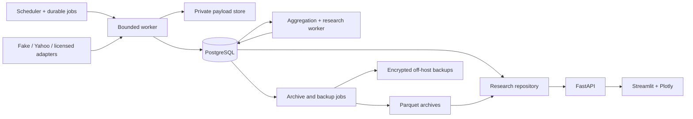

# 01 — Architecture and decisions

## System shape

One Python package, one database, one authoritative scheduler, and a small number of container processes. Provider adapters return typed observations; they never write SQL or decide research eligibility. The worker owns ingestion transactions. Research services read immutable facts through a repository interface. The UI uses the same HTTP API as exports.



Ingest and analytics jobs share one worker pool with separate priority lanes. Bounded concurrency starts at one provider request and one analytical job; DB transactions stay short. Never hold a transaction open during HTTP requests or Parquet writes. Separate processes may scale later without changing contracts.

## ADR register

| ADR | Decision and reason | Alternative / consequence / revisit trigger |
|---|---|---|
| 001 Runtime | Python 3.12, uv lockfile, Pydantic v2, SQLAlchemy 2 + psycopg 3, Alembic; synchronous provider calls in worker processes | Async everywhere adds little at this rate; API may use sync handlers safely. Pin resolved patches during scaffold; no floating images |
| 002 Database | PostgreSQL 18 with native monthly partitions for snapshots and bars | SQLite limits concurrent ops/recovery; TimescaleDB adds an extension dependency. Revisit after query/index tuning fails measured targets |
| 003 Scheduling | DB job queue, one scheduler with dedicated-session advisory lock, transactional claims and lease fencing | No Celery/Redis/APScheduler second authority; this keeps restart state inspectable |
| 004 Services | Compose: db, migrate (one-shot), scheduler, worker, api, ui; optional monitoring profile | No Kubernetes/Kafka. Single VPS failure is accepted and mitigated by off-host restore |
| 005 Observation storage | Append all selected periodic observations, including unchanged quotes; immutable corrections and raw hashes | Changed-only storage is reserved for live events; it otherwise obscures sampling and failed polls |
| 006 Bars | One versioned `bar_observations` relation with timeframe views; precompute 5m/15m/4h on dirty ranges | Query-time full aggregation is costly and hard to reproduce. Canonical 1m is preserved; daily comes separately |
| 007 4h convention | Session-open anchored `[09:30,13:30)` and `[13:30,16:00)` normally | Fixed UTC grids cross sessions/DST. Second bar is a complete 150-minute remainder when all constituents exist, not a full four-hour period |
| 008 Price basis | `provider_native`, verified `as_traded`, `split_adjusted`, or `total_return_adjusted`, with policy version and provenance | Do not call all `auto_adjust=False` histories raw. Mixing bases is rejected by default |
| 009 Time semantics | Event time, fetch window, persisted knowledge time, last trade time, and derived publication time stay distinct | Snapshot labels use fetch completion, not fabricated event times or rounded poll slots |
| 010 Research | Explicit `observed` vs `recomputed` availability, point-in-time revisions, no silent forward fill | Ordinary “latest” queries are separate from causal datasets |
| 011 UI | Streamlit + Plotly via API; two vertically aligned panels, common UTC axis | Faster delivery than a SPA; revisit on measured concurrent-user or chart interaction needs |
| 012 Archives | PyArrow Parquet/Zstd; DuckDB scan behind repository, bounded export jobs | CSV is an output, never the write store. Checksummed manifests control hot/cold deduplication |
| 013 Authentication | Bind API/UI to loopback, operator VPN/SSH access; API bearer token, private DB network | Public multi-user service is out of scope; an authenticated proxy is required before public binding |
| 014 Models | Descriptive quote metrics first; American-aware models later with versioned curves/dividends | A generic European model is not an unlabeled fair-value engine for American equity options |
| 015 Compliance | Live source is opt-in and governed by a recorded rights/capabilities policy | An unofficial package and public endpoint do not confer data entitlement |

### Bar details that implementations must share

All intervals are half-open `[start,end)` with the chart x coordinate at `start`; API also returns `end`, session date, actual duration, policy ID, expected/observed minute counts, and availability. Normal US RTH has 390 minute starts from 09:30 through 15:59. A 13:00 early close produces one 210-minute 4h bucket. UI labels it “4h session bucket (3h30 early close)”. Normal remainder label is “4h session bucket (2h30 remainder)”. `is_short_session_bucket` is independent of `complete`.

Do not synthesize missing zero-volume minutes. Missing source bars, exchange-confirmed halts, and proven no-trade minutes have distinct quality reasons. Default completeness requires every scheduled constituent; a future policy can handle authoritative halt/no-trade intervals under a new version. Daily reconciliation uses only matching session and price basis and reports discrepancies without replacing the provider daily record.

### Corporate actions and identity

Underlying UUIDs survive ticker changes. Provider symbols have effective and knowledge intervals. Contract UUIDs denote economic terms; provider symbols are mapped with source, valid interval, and knowledge time. Contract terms revisions preserve multiplier, deliverable, style, settlement, expiry timestamp, and evidence. A changed deliverable creates a new terms revision or a distinct economic contract when identity is not equivalent; never rewrite old terms. OCC-style parsing is a consistency check, not authoritative identity. Do not equate two contracts on strike/expiry alone.

Historical as-traded option prices may only be compared with a compatible underlying basis. A current split-normalized backfill cannot be treated as an executable historical spot series. Adjusted total-return data are useful for returns but must remain a separate dataset.

## Proposed repository and ownership

Paths below are **to be created by tickets**, not claims that software exists today.

```text
pyproject.toml, uv.lock                 # foundation/integrator only
src/marketagg/
  cli.py, settings.py, logging.py       # foundation
  domain/                              # contract owner; no I/O
    observations.py, identifiers.py, capabilities.py, policies.py
  providers/                           # provider owners
    base.py, fake.py, yahoo.py, licensed.py
  db/                                  # persistence owner
    models.py, repository.py, ingest.py, jobs.py, publication.py
  calendar/                            # time/calendar owner
    sessions.py, registry.py
  scheduler/                           # scheduler owner
    planner.py, leases.py, budgets.py
  collectors/                          # ingestion owner
    bars.py, options.py, discovery.py, quality.py, recovery.py
  analytics/                           # research owner
    aggregate.py, asof.py, quote_metrics.py, surfaces.py, models.py
  research/                            # dataset owner
    datasets.py, manifests.py, costs.py, replay.py
  storage/                             # archive owner
    payloads.py, parquet.py, catalog.py, restore.py
  api/                                 # API owner
    app.py, schemas.py, routes/, auth.py
ui/                                    # UI owner; only HTTP reads
migrations/versions/                   # persistence owner serializes revisions
config/                                # reviewed YAML, no secrets
  universe.yaml, policies.yaml, providers.yaml
deploy/                                # operations owner
  compose.yaml, Dockerfile, monitoring/, backup/, runbooks/
tests/
  fixtures/, unit/, contracts/, integration/, acceptance/, performance/
scripts/                               # reproducible check/probe commands
reports/                               # evidence, no credentials or restricted payloads
docs/build-guide/                      # this handoff
```

Domain types and API schemas must not import yfinance or pandas. Adapter mappings convert dataframe quirks, NaN/NaT, Decimal, and timezone details at the boundary. Storage repositories expose both hot and archived data under a single query contract. Analytics are pure functions where possible; time, RNG, provider, and repository are injectable.

## Interface ownership and integration rules

The foundation agent owns CLI names, test markers, lockfile, CI, and shared enums. The persistence agent owns all migration numbering and DB invariants. Other agents propose schema diffs in their ticket branch; they do not independently merge conflicting migration heads. API owns OpenAPI; UI uses checked-in generated/example responses. Contract changes need a version bump, fixture updates, and both producer/consumer review.

Agents may work in separate worktrees after shared contracts merge. No two agents edit the same shared path concurrently. Every ticket closes with artifact paths, tests actually run, limitations, and sample evidence. A skipped live test is reported as skipped, never successful coverage.
