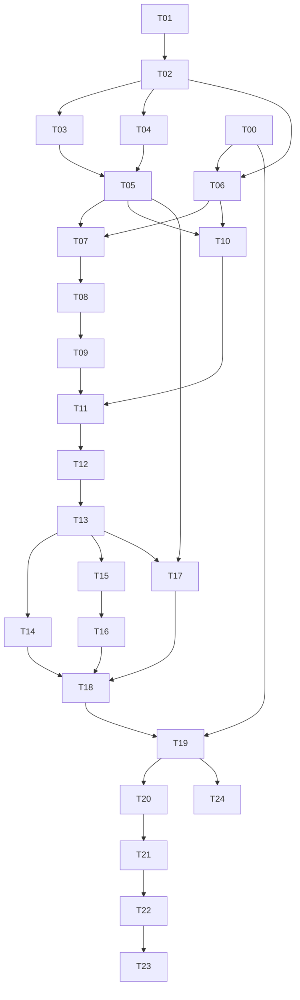

# 04 — Agent execution roadmap

This is the ordered implementation backlog. Ticket commands are **commands the implementation must make work**, not tests already present or run. Paths are relative to repository root. Use one ticket per reviewable change; L tickets may split internally without changing shared contracts. Complexity: S roughly 0.5–1 engineer day, M 1–3, L 3–5; these are human engineering estimates, not agent runtime promises. Source access and five-session pilot elapsed time are additional. Plan roughly 6–10 engineer weeks for a tested MVP, with high variance from provider issues.

## Common completion contract

For every ticket: stay within owned paths; implement documented interfaces; add the named meaningful tests; pass `uv run ruff check .`, `uv run mypy src/marketagg`, and relevant pytest paths; report actual commands/results. Document data migration and compatibility effects. Do not weaken temporal/source-quality gates to get a green build. Unit tests are network-free. Integration tests use disposable PostgreSQL 18; live probes are explicit opt-in. Secrets and unlicensed payloads never enter fixtures.

The integrator owns shared files, reviews cross-boundary changes, and records evidence under `reports/tickets/Txx.md`. Every review checks input/output semantics, error behavior, temporal availability, idempotency, and paths. Test commands below assume T01 has installed the CLI and test framework.

## Phase gates

| Phase | Tickets | Definition of done / review focus |
|---|---|---|
| 0 Feasibility | T00, later T19 live pilot | Evidence distinguishes observed capability from assumption; live source gate unresolved until pilot |
| 1 Foundation | T01–T05 | Deterministic fake provider, migrations, calendar, durable jobs, clean bootstrap; no live access required |
| 2 Underlying | T06–T09 | Daily and 1m preserve revisions; correct 5m/15m/4h boundaries and missingness |
| 3 Options | T10 | Discovery, identity, expiry budget, immutable snapshots, partial coverage and restart tests |
| 4 Research/API | T11–T13, T15 | Causal joins, versioned descriptive metrics, bounded API, reproducible exports |
| 5 Exploration | T14 | Both panels, contract browser, quality/freshness labels, useful empty/error states |
| 6 Operations | T16–T19 | Archives, private deployment, verified off-host recovery, measured capacity; mandatory for MVP release |
| 7 Quant | T20–T23 | Verified model inputs, interpolation diagnostics, cost-aware replay and paper-only alerting |
| 8 Feed upgrade | T24 | Entitled feed, replay/gap recovery, shadow comparison, unchanged API |

## Tickets

### T00 / Source feasibility and rights inventory — M, feasibility owner

**Goal:** Resolve what the initial source can support without inventing freshness or historical data.
**Prerequisites:** Documents 00–03; live permission review precedes network probes.
**Scope and owned paths:** `scripts/probe_provider.py`, `reports/feasibility/`, `tests/unit/test_probe_report.py`.
**Inputs / outputs / interfaces:** Source evidence -> capability JSON, limits, field mappings, request budget, rights status.
**Implementation steps:** Pin tested version; implement dry-run fake probe first; perform bounded experiments in 00 if permitted; capture cold/warm request behavior, split example, null rates, and precise unverified items.
**Acceptance criteria:** Each capability has evidence/date/confidence; 1m span vs age separated; no historical chain claim; live source can remain blocked without blocking fixture builds.
**Test commands and expected results:** `uv run pytest tests/unit/test_probe_report.py` passes; `uv run python scripts/probe_provider.py --provider fake --output reports/feasibility/fake` produces deterministic report; live evidence is clearly separate.
**Risks / edge cases:** HTTP success with empty data, implicit adjustment, hidden retries, jurisdiction-specific terms.
**Do not change:** Runtime modules, global dependency lock independently of T01, or permission status without evidence.

### T01 / Project scaffold and reproducible developer environment — M, foundation owner

**Goal:** Provide the runnable package and common quality commands.
**Prerequisites:** Accepted guide defaults; T00 can run in parallel.
**Scope and owned paths:** `pyproject.toml`, `uv.lock`, `.gitignore`, `.env.example`, `src/marketagg/{__init__.py,cli.py,settings.py,logging.py}`, `tests/conftest.py`, `tests/unit/test_settings.py`, `.github/workflows/ci.yml` if GitHub is selected.
**Inputs / outputs / interfaces:** Typed config and CLI contract; default provider fake; secret redaction.
**Implementation steps:** Set Python 3.12; resolve/pin dependencies; register `marketagg`; define pytest markers `integration,acceptance,performance,live`; document Linux and Windows commands; add structured UTC logs and configuration validation.
**Acceptance criteria:** Fresh `uv sync --frozen --all-extras` succeeds; `marketagg --help` and `config check` work; missing secrets cannot enable live source; logs redact tokens.
**Test commands and expected results:** `uv run pytest tests/unit/test_settings.py` passes; `uv run marketagg config check --profile fixture` exits zero; invalid budget exits nonzero.
**Risks / edge cases:** Windows path/UTC behavior, lockfile reproducibility, dev/prod config divergence.
**Do not change:** Original brief, schemas, provider behavior; coordinate all later dependency changes.

### T02 / Canonical contracts and deterministic fake provider — M, contract owner

**Goal:** Freeze provider/domain boundaries before parallel implementation.
**Prerequisites:** T01.
**Scope and owned paths:** `src/marketagg/domain/`, `providers/{base.py,fake.py}`, `tests/contracts/test_provider.py`, `tests/fixtures/synthetic/`.
**Inputs / outputs / interfaces:** Protocols and JSON schemas from 02; scripted fake observations and errors.
**Implementation steps:** Define frozen models, enums, Decimal/UTC rules, capability flags, quality codes and errors; fake clock/RNG; include two expiries, calls/puts, missing sides, revisions, null and zero values, partial responses.
**Acceptance criteria:** Provider contract contains no pandas/yfinance types; replay deterministic; unverified timestamps/terms stay unknown; canonical parser rejects nonfinite values.
**Test commands and expected results:** `uv run pytest tests/contracts/test_provider.py` passes for fake; golden JSON serialization round-trip stable.
**Risks / edge cases:** Nanosecond precision, naive datetime input, nullable fields, finite float enforcement.
**Do not change:** DB migrations or API shape without integrator review.

### T03 / Persistence migrations and publication repositories — L, database owner

**Goal:** Implement auditable persistence from the reference DDL.
**Prerequisites:** T01, T02.
**Scope and owned paths:** `migrations/`, `src/marketagg/db/`, `tests/integration/test_{migrations,persistence,publication}.py`; test DB Compose definition in coordination with T17.
**Inputs / outputs / interfaces:** DDL + domain models -> migration chain, typed repositories and roles.
**Implementation steps:** Implement four reserved migrations; partition provisioning for requested ranges; publish-after-commit protocol; alias/bar locking; correction/invalidation resolver; writer/read/export/backup privileges; restricted SQL entry points.
**Acceptance criteria:** Empty DB upgrades to one head; repeated response is idempotent; distinct polls persist; prepublication/stale-fence facts invisible; wrong-source/ambiguous identities rejected; archive-safe logical refs validated.
**Test commands and expected results:** `uv run alembic upgrade head`; `uv run pytest tests/integration/test_migrations.py tests/integration/test_persistence.py tests/integration/test_publication.py` pass against PostgreSQL 18, including concurrency and crash fixtures.
**Risks / edge cases:** Partition keys in uniqueness, unknown historical partition ranges, invalidation without overwriting, staged orphans.
**Do not change:** Data semantics to simplify SQL; other agents must not create migration heads concurrently.

### T04 / Sessions, expiry conventions, and identity time helpers — M, calendar owner

**Goal:** Make session and DTE logic deterministic.
**Prerequisites:** T01, T02.
**Scope and owned paths:** `src/marketagg/calendar/`, `tests/unit/test_calendar.py`, synthetic calendar fixtures.
**Inputs / outputs / interfaces:** Pinned calendar library + versioned policy -> UTC intervals and expected minute index.
**Implementation steps:** Left-labeled half-open minutes; holidays, DST, early closes; product override metadata; calendar-day DTE and separate expiry cutoff; compare known calendar fixtures to exchange notices.
**Acceptance criteria:** Normal day 390 minutes and 4h buckets 240/150; early-close day 210; no phantom overnight/weekend minutes; unknown expiry cutoff not guessed.
**Test commands and expected results:** `uv run pytest tests/unit/test_calendar.py` passes for 2025-03-07/10, 2025-11-28, holidays, and synthetic exceptional closure.
**Risks / edge cases:** Options hours differ from equities; future emergency closures; timezone conversion.
**Do not change:** Collection cadence, provider assumptions, underlying canonical session policy silently.

### T05 / Durable scheduler, leases, and budget planner — L, scheduler owner

**Goal:** Bound requests and recover safely from restarts.
**Prerequisites:** T02, T03, T04.
**Scope and owned paths:** `src/marketagg/scheduler/`, worker orchestration module, `tests/integration/test_scheduler.py`, `tests/unit/test_budget.py`.
**Inputs / outputs / interfaces:** Configured scope/calendar -> idempotent job intents and fenced attempts.
**Implementation steps:** Single scheduler advisory lock; claim/heartbeat/fence; priorities/deadlines; token pacing; retry/circuit rules; overdue-live skip behavior; adapter call accounting.
**Acceptance criteria:** Two schedulers produce one logical job; stale worker cannot commit; restart does not replay old chain slots as history; planned and actual budgets visible; broad work sheds first.
**Test commands and expected results:** `uv run pytest tests/integration/test_scheduler.py tests/unit/test_budget.py` passes with fake clock, competing workers, 429, Retry-After, and lease loss.
**Risks / edge cases:** Lock connection pooling, hidden library requests, clock jumps, growing backlogs.
**Do not change:** Provider transport implementation or timestamp truth rules.

### T06 / Yahoo adapter and source qualification — M, provider owner

**Goal:** Map the approved package into canonical observations.
**Prerequisites:** T00 evidence (or fake-only development status), T02.
**Scope and owned paths:** `src/marketagg/providers/yahoo.py`, `tests/contracts/test_yahoo_mapping.py`, sanitized/synthetic adapter fixtures.
**Inputs / outputs / interfaces:** Pinned library outputs -> FetchResult and ProviderCapabilities.
**Implementation steps:** Explicit adjustment/prepost/repair settings; cache discovery; nullable field mapping; exception categorization; request/response accounting; representation flag for retained adapter results.
**Acceptance criteria:** Event timestamps and sizes stay null when absent; no inferred multiplier solely from symbol; no universal real-time status; schema changes observable; opt-in live gate honored.
**Test commands and expected results:** `uv run pytest tests/contracts/test_yahoo_mapping.py` passes offline; approved `marketagg probe --provider yahoo` writes capability evidence or explicit failure.
**Risks / edge cases:** DataFrame MultiIndex changes, auto-adjust defaults, empty calls/puts, ticker suffixes.
**Do not change:** Canonical contracts, schedule budgets, data-use status without review.

### T07 / Daily backfill, actions, and reconciliation basis — M, underlying owner

**Goal:** Build daily history with honest adjustment and availability semantics.
**Prerequisites:** T03, T04, T05, T06 (fake may substitute for development).
**Scope and owned paths:** `collectors/bars.py` daily portion, `collectors/actions.py`, `tests/integration/test_daily.py`.
**Inputs / outputs / interfaces:** Date chunks -> daily revisions, actions, coverage and resume cursors.
**Implementation steps:** Annual chunks and overlap; preserve actual arrival; version actions; label basis; delisting/symbol-change handling; daily-to-intraday QC interface.
**Acceptance criteria:** Repeated chunks don't duplicate unchanged bars; changed values append; split fixtures cannot mix incompatible price bases; empty history does not imply delisting.
**Test commands and expected results:** `uv run pytest tests/integration/test_daily.py` passes including crash/resume and backfilled-today exclusion from old observed decisions.
**Risks / edge cases:** Provider split normalization, changing historical adjustments, source date labels.
**Do not change:** Option term assumptions or original history.

### T08 / Rolling minutes and gap recovery — L, underlying owner

**Goal:** Persist canonical 1m and recover available gaps.
**Prerequisites:** T07; serialize with its shared bars module.
**Scope and owned paths:** `collectors/bars.py` intraday portion, `collectors/recovery.py`, `tests/integration/test_minutes.py`.
**Inputs / outputs / interfaces:** Rolling windows + calendar -> versioned minutes, gaps, dirty ranges.
**Implementation steps:** Closed-bar filtering, 20m overlap, end-session sweeps, range-vs-age limits, earliest-expiring gap repair, changed-content comparison, invalidation records.
**Acceptance criteria:** Missing minutes are not synthesized; unsupported historical gaps marked unrecoverable; revision invalidation propagates; future/unclosed intervals excluded from research.
**Test commands and expected results:** `uv run pytest tests/integration/test_minutes.py` passes for gaps, disorder, duplicates, halts, revised bars, and exhausted source horizon.
**Risks / edge cases:** No-trade vs missing distinction, partial latest bar, old partitions, price basis shifts.
**Do not change:** Aggregation or daily schemas independently.

### T09 / Deterministic aggregation and correction propagation — M, analytics owner

**Goal:** Publish reproducible 5m/15m/session-4h candles.
**Prerequisites:** T03, T04, T08.
**Scope and owned paths:** `analytics/aggregate.py`, `tests/unit/test_aggregate.py`, `tests/integration/test_reaggregation.py`.
**Inputs / outputs / interfaces:** Eligible 1m revisions -> derived bar revisions + input lineage.
**Implementation steps:** Calendar-aligned grouping; count completeness; publish remainder duration; dirty-window dedup; explicit publication lag; daily comparison reports.
**Acceptance criteria:** Correct OHLCV and expected counts; incomplete/invalidated bucket rejected by research; late correction creates a new version while old asof remains unchanged.
**Test commands and expected results:** `uv run pytest tests/unit/test_aggregate.py tests/integration/test_reaggregation.py` passes including 240/150 and 210-minute fixtures.
**Risks / edge cases:** Volume nulls, partial window boundaries, stale materializations, mixing policies.
**Do not change:** Underlying minutes, calendar conventions, point-in-time requirements.

### T10 / Options discovery, scope planning, and snapshots — L, options owner

**Goal:** Accumulate honest five-minute observations of a bounded universe.
**Prerequisites:** T03–T06; T08 required only for optional spot-based retention filter.
**Scope and owned paths:** `collectors/{options.py,discovery.py,quality.py}`, `tests/integration/test_options.py`.
**Inputs / outputs / interfaces:** Discovery + expiry plan -> contracts/terms, memberships, batches/snapshots and scope reports.
**Implementation steps:** Stable source mappings; four-expiry selection; shared fetches across tiers; complete/partial/empty classifications; nullable quote fields; no-trade/volume/OI semantics; postcommit publication.
**Acceptance criteria:** Two equal-price polls yield two observations; response replay yields one; partial puts preserve calls with coverage flag; unknown terms excluded from models; distinct fetch time per expiry retained.
**Test commands and expected results:** `uv run pytest tests/integration/test_options.py` passes for corrections, missing sides, ambiguous identifiers, expiry roll, null/zero, and request-cost assertions.
**Risks / edge cases:** Nonstandard deliverables, symbol reuse, split-adjusted options, exploding expiry counts.
**Do not change:** Provider code, common schemas, or source-quality gates without owner review.

### T11 / Causal query service and input eligibility — L, temporal owner

**Goal:** Guarantee no observed future information enters a decision dataset.
**Prerequisites:** T09, T10.
**Scope and owned paths:** `analytics/asof.py`, research repository query layer, `tests/integration/test_asof.py`.
**Inputs / outputs / interfaces:** Decision cutoff, source/basis policy, availability mode -> eligible facts and explicit exclusions.
**Implementation steps:** Knowledge-first revision selection; bitemporal identity/terms; same-session spot joins; event-time strict mode; age limits; observed vs causal-recomputed mode; correction/invalidation resolution.
**Acceptance criteria:** The adversarial delayed/corrected fixtures in 05 cannot leak; unknown quote time remains unknown; old backfill rejected in observed mode; no cross-session stale carry.
**Test commands and expected results:** `uv run pytest tests/integration/test_asof.py` passes and includes mutation tests that would fail if knowledge predicates were removed.
**Risks / edge cases:** Latest-first query bug, archived revisions, selection bias, false synchronization.
**Do not change:** Raw timestamps or relax rules for an attractive chart.

### T12 / Descriptive quote metrics and simple term/skew panels — M, analytics owner

**Goal:** Expose useful metrics with source and method labels.
**Prerequisites:** T11.
**Scope and owned paths:** `analytics/quote_metrics.py`, `tests/unit/test_quote_metrics.py`.
**Inputs / outputs / interfaces:** Eligible quotes and optional compatible spot -> midpoint/spread, provider-reported IV curve, moneyness skew, diagnostics.
**Implementation steps:** Null/zero/crossed handling; explicit near-ATM definition; same-cycle skew bound; version formulas; retain reported vs calculated origin; return unavailable where IV/basis unsuitable.
**Acceptance criteria:** No Greeks invented; timestamp-unknown outputs marked descriptive/temporally uncertain; repeated OI/volume not summed; absent expiries visible.
**Test commands and expected results:** `uv run pytest tests/unit/test_quote_metrics.py` passes for zero denominator, impossible IV, mismatched spot basis and wide spreads.
**Risks / edge cases:** Reported-IV calculation assumptions unknown, stale underlying, sparse strikes.
**Do not change:** Model/constant-delta API claims before T20/T21.

### T13 / Research HTTP API — M, API owner

**Goal:** Publish stable private data/query contracts.
**Prerequisites:** T11, T12; may scaffold against T02 fixtures earlier.
**Scope and owned paths:** `src/marketagg/api/`, `tests/contracts/test_api.py`, `docs/api/openapi.json`.
**Inputs / outputs / interfaces:** Routes in 02 -> versioned JSON with quality/coverage/availability.
**Implementation steps:** Auth, cursor pagination, bounded queries, stable error envelope, readiness, schema generation, async export status interface.
**Acceptance criteria:** No unbounded scans by default; invalid basis gives 409; null freshness preserved; no secrets in health/errors; identical source-independent routes.
**Test commands and expected results:** `uv run pytest tests/contracts/test_api.py` passes; generated OpenAPI diff reviewed; query limits enforced.
**Risks / edge cases:** Decimal serialization, pagination under new ingestion, SQL injection, token leakage.
**Do not change:** Query temporal semantics or add direct provider fetching in HTTP handlers.

### T14 / Private research dashboard — M, UI owner

**Goal:** Make the accumulated data inspectable.
**Prerequisites:** T13 contract; fixtures permit parallel UI development after schema freeze.
**Scope and owned paths:** `ui/`, `tests/acceptance/test_ui.py`, `reports/ui/` screenshots.
**Inputs / outputs / interfaces:** API only -> instrument/contract browser and aligned candlestick/options panels.
**Implementation steps:** 1m/5m/15m/4h/daily selection; shared axis and sampling cutoff; calls/puts/strike filtering; midpoint/bid/ask/IV toggles; quality/gap overlays; export status links.
**Acceptance criteria:** UI explains shortened 4h remainder; unknown quote time conspicuous; no filled line across missing sessions by default; empty data and stale scope readable; source/adjustment shown.
**Test commands and expected results:** `uv run pytest tests/acceptance/test_ui.py` passes using fixture API; manual screenshot review confirms normal/early-close/empty/error layouts.
**Risks / edge cases:** Large timeseries, user-local timezone confusion, partial charts, misread option sampling.
**Do not change:** API semantics or access PostgreSQL directly.

### T15 / Reproducible point-in-time exports — M, dataset owner

**Goal:** Produce audit-ready CSV/Parquet research datasets.
**Prerequisites:** T11, T13.
**Scope and owned paths:** `research/{datasets.py,manifests.py}`, `tests/integration/test_exports.py`.
**Inputs / outputs / interfaces:** DatasetRequest -> bounded job, canonical manifest, files and checksums.
**Implementation steps:** Pin universe/inputs/revisions/policies; include exclusions, source capabilities, availability mode and costs; deterministic sorting/serialization; formula-safe CSV strings; private expiring download authorization.
**Acceptance criteria:** Same pinned request yields same semantic content hash; no later corrections affect old export; missing data summarized; cancelled/failed jobs leave no published partial file.
**Test commands and expected results:** `uv run pytest tests/integration/test_exports.py` passes including pagination, restart, malicious CSV cell, and later-revision immutability.
**Risks / edge cases:** Parquet file metadata byte variation (use semantic hash plus file checksum), storage exhaustion, excessive ranges.
**Do not change:** Source licensing or causal cutoff rules for export convenience.

### T16 / Archives and unified hot/cold reads — L, storage owner

**Goal:** Retain history affordably without losing temporal queries.
**Prerequisites:** T03, T11, T15.
**Scope and owned paths:** `storage/`, `tests/integration/test_archive.py`.
**Inputs / outputs / interfaces:** Immutable partitions + metadata -> checksummed generations and ResearchRepository reads.
**Implementation steps:** Partitioned Parquet/Zstd; staged/verified/active manifest; round-trip types/row identity; include batch/identity/policy dependencies; late correction delta; deduplicate hot/cold by immutable identity; atomic reader catalog pin.
**Acceptance criteria:** Hot-only, mixed and restored results agree; missing/corrupt object fails visibly; interrupted archive never causes data loss; pruning requires offsite verification and grace.
**Test commands and expected results:** `uv run pytest tests/integration/test_archive.py` passes for duplicate overlap, nanoseconds/Decimal/nulls, interrupted activation, late correction and restore.
**Risks / edge cases:** Small files, schema evolution, metadata loss, pinned export references.
**Do not change:** Original available times or prune before required verification.

### T17 / Compose, private access, monitoring, and backups — L, operations owner

**Goal:** Make the VPS deployable and observable from the first pilot.
**Prerequisites:** T01, T03, T05; production readiness additionally requires T13.
**Scope and owned paths:** `deploy/`, `.env.example` with foundation owner, `tests/integration/test_deployment.py`, operations CLI extensions via integrator.
**Inputs / outputs / interfaces:** Configured image/DB -> private Compose stack, alerts, backup jobs, runbooks.
**Implementation steps:** Digest-pinned images, health dependencies, one-shot migration, non-root processes, resource/pool limits; no public DB binding; structured metrics; encrypted backups with checksums; secret mounting; disk pressure policies.
**Acceptance criteria:** Fresh deployment ready; restart retains state; API auth works; backup verifies offsite; operator sees per-scope stalled ingestion, unknown freshness, backlog, disk and backup status.
**Test commands and expected results:** `docker compose -f deploy/compose.yaml config --quiet`; `uv run pytest tests/integration/test_deployment.py` pass; `marketagg ops backup --verify` creates evidence.
**Risks / edge cases:** Docker daemon privileges, disk full, unbounded WAL/logs, secret echo, unhealthy migration.
**Do not change:** Production host firewall or purchase services without deployment authorization; implementation remains local/testable.

### T18 / End-to-end acceptance and disaster-recovery drill — M, integration owner

**Goal:** Prove the complete research and recovery path.
**Prerequisites:** T14–T17 and all ingestion/query tickets.
**Scope and owned paths:** `tests/acceptance/test_pipeline.py`, `tests/acceptance/test_restore.py`, `scripts/run_acceptance.py`, `reports/acceptance/`.
**Inputs / outputs / interfaces:** Fixture session -> ingestion, panels, export, archive, clean-instance restore report.
**Implementation steps:** Execute scenarios A01–A10 in 05; kill workers at each durable boundary; simulate disk/corrupt archives; restore offsite backup to separate database; verify pinned dataset hashes.
**Acceptance criteria:** All fixture scenarios pass; RPO/RTO measured; original DB never used for restored queries; no unreported temporal violations; operational limits documented.
**Test commands and expected results:** `uv run python scripts/run_acceptance.py --profile fixture`; `uv run pytest tests/acceptance/test_restore.py` exit zero and generate signed-off evidence manifest.
**Risks / edge cases:** Accidentally restoring over live DB, incomplete metadata backup, misleading small-fixture performance.
**Do not change:** Acceptance thresholds to hide failures; never delete production data for a drill.

### T19 / Five-session pilot and MVP release decision — M + elapsed sessions, release owner

**Goal:** Replace capacity assumptions with measurements.
**Prerequisites:** T00 rights/capability gate, T18, approved live configuration.
**Scope and owned paths:** `reports/pilot/`, `scripts/measure_capacity.py`, capacity/config proposals.
**Inputs / outputs / interfaces:** Small live universe -> cost/storage/lag/error/coverage report and release checklist.
**Implementation steps:** Run five trading sessions; capture effective request rate and per-scope coverage; extrapolate storage; test backup during ingestion; document Yahoo uncertainty; recommend bounded universe/cadence.
**Acceptance criteria:** All mandatory release gates in 05/06 satisfied or release explicitly withheld; no claim of execution-grade freshness; every skipped scope counted; projected disk headroom >=30 days.
**Test commands and expected results:** `uv run python scripts/measure_capacity.py --sessions 5 --output reports/pilot`; `uv run marketagg release check --report reports/pilot` exits zero only with complete evidence.
**Risks / edge cases:** Unrepresentative week, provider throttling, partial data, unapproved data-use rights.
**Do not change:** Five-minute label when cadence degraded; publish a measured scope limitation instead.

### T20 / Versioned valuation inputs and American-aware model — L, quant owner

**Goal:** Add explicit theoretical estimates and computed Greeks.
**Prerequisites:** MVP release T19; verified rate/dividend/contract-term input rights and timing.
**Scope and owned paths:** `analytics/models.py`, `research/model_inputs.py`, `tests/unit/test_models.py`.
**Inputs / outputs / interfaces:** Eligible event-comparable prices and immutable curves/dividends/terms -> model outputs and diagnostics; Yahoo may be descriptive-only or unavailable.
**Implementation steps:** Select documented American binomial/finite-difference engine; convergence grid; dividends/early exercise; bracketed IV inversion; units/sign conventions; European benchmark only for valid limit cases.
**Acceptance criteria:** Known benchmarks/tolerances pass; solver failure returns null reason; no real-data values from synthetic rates; model-origin fields explicit; uncertainty from quote interval reported.
**Test commands and expected results:** `uv run pytest tests/unit/test_models.py` passes convergence, monotonicity, dividend, expiry and IV-repricing tests.
**Risks / edge cases:** Adjusted deliverables, deep ITM, discontinuous exercise, inaccurate expiry/borrow assumptions.
**Do not change:** Reported provider IV/quotes or silently mark calculated Greeks as native.

### T21 / Constant-maturity and 25-delta surfaces — L, quant owner

**Goal:** Build 30/60/90-day and 25Δ features with bounded interpolation.
**Prerequisites:** T20, sufficient eligible bracketing expiries/strikes.
**Scope and owned paths:** `analytics/surfaces.py`, `tests/unit/test_surfaces.py`.
**Inputs / outputs / interfaces:** Per-expiry model/reported-IV inputs with declared method -> surface points, weights, diagnostics.
**Implementation steps:** Define signed spot delta convention; interpolate within same-expiry strikes; total-variance interpolation across bracketing maturities; no extrapolation; spread/skew filters; archive full lineage.
**Acceptance criteria:** Missing brackets yield unavailable; target 90d outside 30–90 sampled maturity support is not extrapolated; method/units and call-vs-put definitions explicit; inconsistent cycles rejected.
**Test commands and expected results:** `uv run pytest tests/unit/test_surfaces.py` passes exact knots, interpolation, no-extrapolation, monotonicity diagnostics and sparse-cycle cases.
**Risks / edge cases:** DTE date vs fractional maturity, nonmonotonic delta, apparent calendar arbitrage from stale quotes.
**Do not change:** Data collection to promise complete surfaces without a reviewed budget expansion.

### T22 / Point-in-time replay and transaction-cost experiments — L, research owner

**Goal:** Evaluate strategies without presenting Yahoo sampling as verified fills.
**Prerequisites:** T15, T20, T21.
**Scope and owned paths:** `research/{replay.py,costs.py}`, `tests/acceptance/test_backtest.py`, example research configs.
**Inputs / outputs / interfaces:** Frozen dataset + strategy/cost config -> decisions, fill assumptions, P&L, exclusion and sensitivity reports.
**Implementation steps:** Walk-forward splits, point-in-time universe, bid/ask entry/exit, configurable latency, fees, size/volume restrictions, assignment/dividend treatment or explicit position exclusions; scenario matrix in 05.
**Acceptance criteria:** Observed vs assumed availability never mixed; strict fill mode rejects timestamp/size unknown inputs; hypothetical mode visibly labeled; adverse costs monotonically reduce otherwise identical returns.
**Test commands and expected results:** `uv run pytest tests/acceptance/test_backtest.py` passes lookahead adversaries and cost accounting fixtures.
**Risks / edge cases:** Survivorship, stale quote fills, selection leakage, corporate actions, early assignment.
**Do not change:** Eligibility gates to increase sample size; report excluded coverage.

### T23 / Persistent paper research alerts — M, research owner

**Goal:** Detect repeated research discrepancies with provenance.
**Prerequisites:** T20, T22; live actionable alerts additionally require T24.
**Scope and owned paths:** `research/alerts.py`, `tests/unit/test_alerts.py`, private API/UI alert view.
**Inputs / outputs / interfaces:** Eligible modeled discrepancies -> persisted paper alert records and in-app display.
**Implementation steps:** Require three distinct observations spanning >=10m; debounce per contract/method; spread/cost/uncertainty thresholds; stale/source-change resets; record every supporting observation.
**Acceptance criteria:** Replayed identical response cannot satisfy persistence; unknown-time Yahoo alerts labeled research-only; no automated order path; notifications disabled unless operator explicitly configures authorized delivery.
**Test commands and expected results:** `uv run pytest tests/unit/test_alerts.py` passes duplicate/restart/stale/threshold cases.
**Risks / edge cases:** Persistent stale quote masquerading as persistent mispricing, alert flooding, data-use restrictions.
**Do not change:** Messaging permissions or add trade execution.

### T24 / Licensed streaming adapter and shadow cutover — L, feed owner

**Goal:** Add an entitled feed without replacing research contracts.
**Prerequisites:** T19; vendor selection/entitlements; document 07 checklist.
**Scope and owned paths:** `providers/licensed.py`, `collectors/stream.py`, `tests/contracts/test_stream.py`, `tests/integration/test_provider_cutover.py`; additive migrations coordinated with database owner.
**Inputs / outputs / interfaces:** Vendor events/sequences -> canonical events/checkpoints, feed health and unchanged API.
**Implementation steps:** Verify scope/entitlements; exact timestamp/sequence storage; reconnect/replay/gap marking; bounded buffering; checkpoint selection; shadow overlap and dataset source policy version; rollback switch.
**Acceptance criteria:** Five-session shadow report; no sequence/time disorder leakage; unknown replay gaps visible; no silent source switching in old datasets; same API contract tests pass.
**Test commands and expected results:** `uv run pytest tests/contracts/test_stream.py tests/integration/test_provider_cutover.py` passes with recorded synthetic disconnect/order scripts; entitled live qualification separate.
**Risks / edge cases:** Feed-specific units/conditions, indicative vs consolidated data, entitlement loss, bursts/drops.
**Do not change:** Canonical API, old source identities, or research history in place.

## MVP cutline

**Essential:** T00–T19: bounded 30–90 DTE sampling, separately sourced daily history, canonical 1m, derived 5m/15m/session-4h, immutable option polls, timestamp/basis truth, causal queries, descriptive midpoint/IV/term/skew panels, contract browser, CSV/Parquet export, private deployment, archiving, monitoring, off-host backup and tested restore. Live Yahoo launch remains contingent on the source gate; a complete fixture deployment can be accepted separately and labeled accordingly.

**After MVP:** T20–T24: computed Greeks/fair value, constant maturity and 25Δ, advanced backtester, persistent alerts, live licensed feed. These remain full planned deliverables, not omitted requirements. Full-market coverage, automated orders, guaranteed Yahoo historical option candles, and execution-grade Yahoo pricing are excluded.

## Dependency graph and safe parallel work



Suggested lanes after contract freeze: (A) database/scheduler/operations, (B) calendar/daily/minutes, (C) provider/options, (D) research/API then UI. T03 is a merge gate for all persistence work; T11 is a merge gate for research integration. T07/T08 share a file and run serially. T09/T12/T20/T21 can share an analytics owner but different files. UI may mock T13 schemas before backend completion. Never let independent agents modify `uv.lock`, CLI dispatch, shared enums, migrations, or API schema simultaneously; request integrator changes. Parallelization is a downstream execution strategy, not a requirement to launch all agents immediately.

## First agent prompt — copy to launch Phase 1

```text
You are the foundation implementation agent for the options market-data aggregator.
Read options_market_data_aggregator_astra_brief.md and README.md, then docs/build-guide/
00 through 07. Implement T01 and T02 only. Do not implement the entire platform.

Create the Python 3.12/uv package, typed configuration, structured redacted logging,
marketagg CLI, quality tooling, test markers, canonical domain/provider contracts,
and deterministic fake provider with synthetic fixtures. Provider=fake is the default.
Use the owned paths and acceptance requirements in T01/T02. Preserve the original brief.

Make all provider timestamps, price-basis uncertainty, nullable values, source capabilities,
and typed failure modes explicit. Do not fabricate quote event times, historical option
candles, contract multipliers, or market-data permission. Do not call live sources.
The future persistence contract is docs/build-guide/schema/001_reference.sql.

Run uv sync --frozen --all-extras, uv run ruff check ., uv run mypy src/marketagg,
uv run pytest tests/unit/test_settings.py tests/contracts/test_provider.py,
and uv run marketagg config check --profile fixture. Fix failures within scope.
If a tool is unavailable, report the exact blocked check; do not claim success.

Finish with files changed, commands and actual results, contract examples, unresolved
decisions with safe defaults, and handoff notes for T03/T04/T06. Update reports/tickets/
T01.md and T02.md. Propose shared contract changes before downstream agents start.
```

The essential unresolved decisions and defaults are maintained in [00](00-assumptions-and-constraints.md). Agents continue fixture work with those defaults and record changes explicitly; only work dependent on unverified permission/capabilities stays gated.
